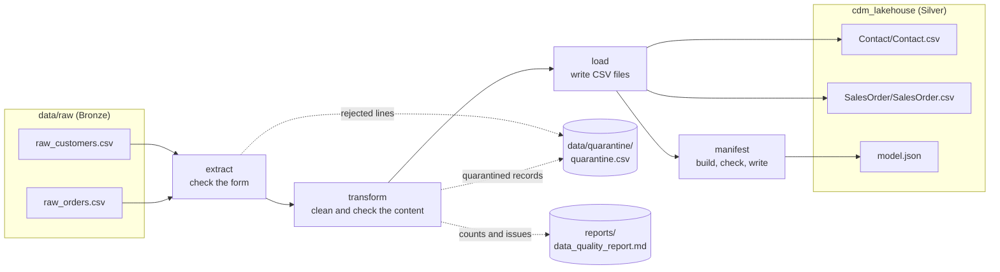
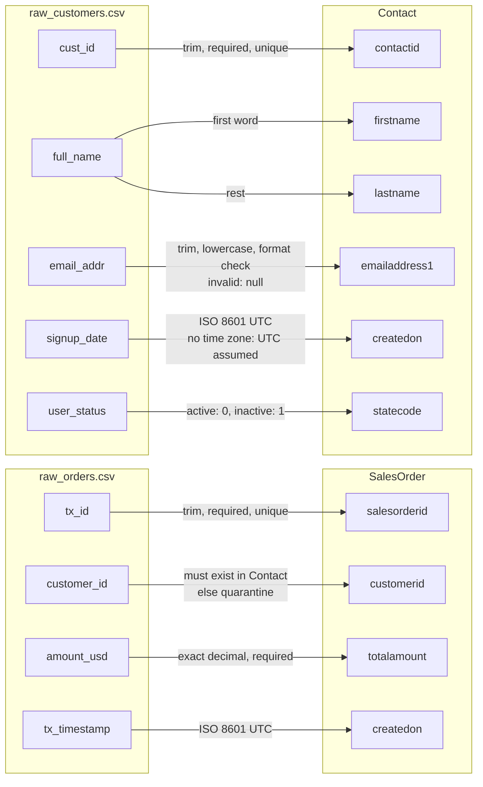
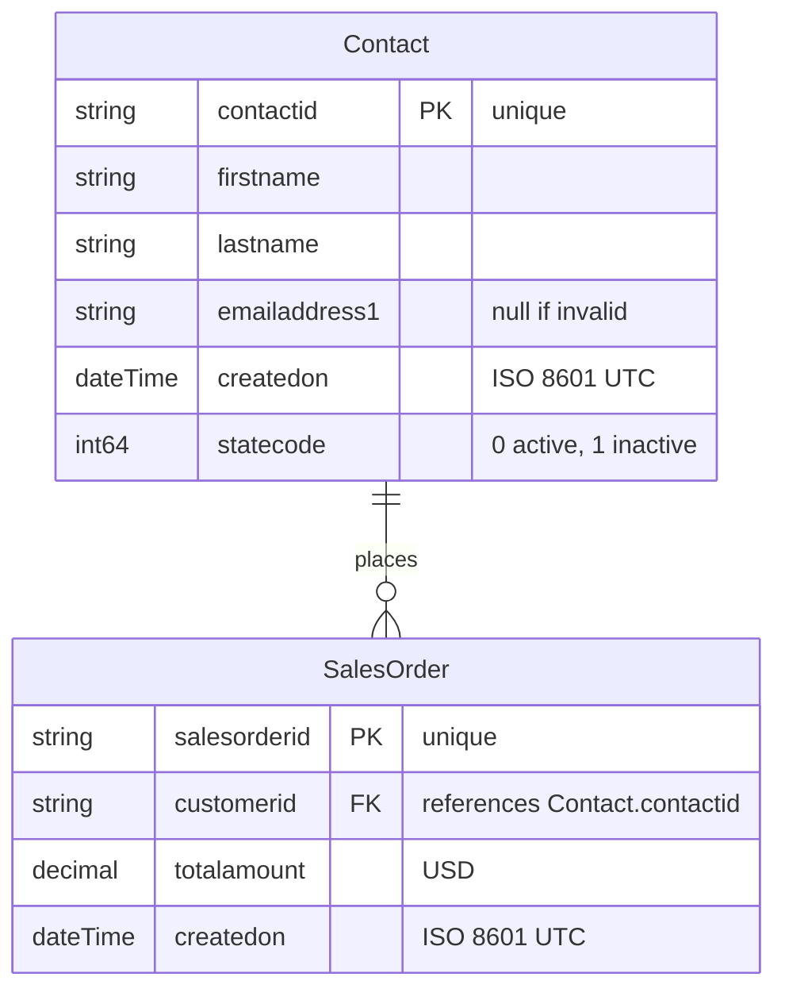
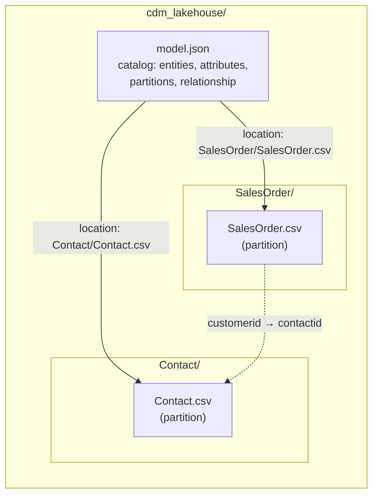

# cdm-lakehouse-pipeline

[](https://github.com/skander10/cdm-lakehouse-pipeline/actions/workflows/ci.yml)

A lightweight Python ETL pipeline that cleans raw customer and order data and stores it as
**Microsoft Common Data Model (CDM)** entities in a local data lakehouse folder, together with a
generated `model.json` manifest.

---

## Overview

The pipeline reads two raw CSV files (`raw_customers.csv`, `raw_orders.csv`), cleans and validates
every record, and writes the CDM entities **Contact** and **SalesOrder** as CSV partitions into
`cdm_lakehouse/`. It then generates `model.json`, the catalog that describes these files, so that
tools such as Power BI or Azure Synapse can read the folder without manual setup.

**Highlights**

- **Clean CDM output**: names split, e-mails normalized, timestamps in ISO 8601 UTC, status codes mapped, amounts as exact decimals.
- **Nothing is lost silently**: invalid records go to a quarantine file with the reason; every
  assumption is logged as a warning.
- **Catalog that matches the data**: `model.json` is generated from one schema definition and checked
  against the written files before it is saved.
- **Quality report**: a readable summary of every run (`reports/data_quality_report.md`).
- **Tested**: 52 unit and end-to-end tests, run with ruff on every push (GitHub Actions).

---

## Quickstart

**Requirements:** Python 3.11 or newer.

```bash
# 1. Clone the repository
git clone https://github.com/skander10/cdm-lakehouse-pipeline.git
cd cdm-lakehouse-pipeline

# 2. Create and activate a virtual environment
python -m venv .venv
source .venv/bin/activate        # Windows: .venv\Scripts\activate

# 3. Install the dependencies (pandas, plus pytest and ruff for development)
pip install -r requirements-dev.txt

# 4. Run the pipeline
python -m src.main
```

**Run the tests and the code checks** (the same checks run in CI):

```bash
python -m pytest
ruff check src tests
ruff format --check src tests
```

---

## What you get

One run of `python -m src.main` creates or overwrites these files:

| File                                      | Content                                                                  |
| ----------------------------------------- | ------------------------------------------------------------------------ |
| `cdm_lakehouse/Contact/Contact.csv`       | CDM entity **Contact** (clean customers)                                 |
| `cdm_lakehouse/SalesOrder/SalesOrder.csv` | CDM entity **SalesOrder** (clean orders)                                 |
| `cdm_lakehouse/model.json`                | CDM manifest: entities, attributes, data types, partitions, relationship |
| `data/quarantine/quarantine.csv`          | Records that were not accepted, with stage and reason                    |
| `reports/data_quality_report.md`          | Summary of the run: counts, quarantined records, issues                  |
| `logs/pipeline.log`                       | Technical log of the run (not committed)                                 |

The output files are committed on purpose, so the result can be reviewed without running anything.
An end-to-end test makes sure they always match what the code produces.

**Log of a run** (record IDs only, no personal data):

```text
INFO    | __main__      | Pipeline started (log file: pipeline.log)
WARNING | src.extract   | raw_customers.csv: line 6 rejected (expected 5 fields, found 2)
WARNING | src.extract   | raw_customers.csv: line 7 rejected (expected 5 fields, found 4)
INFO    | src.extract   | raw_customers.csv: 4 rows read, 2 rejected
INFO    | src.extract   | raw_orders.csv: 5 rows read, 0 rejected
WARNING | src.transform | Contact CST-002: createdon no time zone given, UTC assumed
WARNING | src.transform | Contact CST-003: emailaddress1 invalid, set to null
WARNING | src.transform | Contact CST-003: createdon no time zone given, UTC assumed
INFO    | src.transform | Contact: 4 records transformed
WARNING | src.transform | SalesOrder ORD-1005: quarantined (orphan: customer CST-999 does not exist)
INFO    | src.transform | SalesOrder: 4 records transformed
INFO    | src.load      | Contact: 4 rows written to Contact/Contact.csv
INFO    | src.load      | SalesOrder: 4 rows written to SalesOrder/SalesOrder.csv
INFO    | src.load      | Quarantine: 3 records written to quarantine.csv
INFO    | src.manifest  | Manifest checked: 2 entities match their data files
INFO    | src.manifest  | Manifest written to model.json
INFO    | src.quality   | Quality report written to data_quality_report.md
INFO    | __main__      | Pipeline finished: 4 contacts and 4 sales orders written, 3 quarantined, 3 issues
```

---

## Project structure

```text
cdm-lakehouse-pipeline/
├── data/
│   ├── raw/                    # Bronze: raw input files, never modified
│   └── quarantine/             # rejected records with the reason
├── cdm_lakehouse/              # Silver: CDM entities + model.json
│   ├── model.json
│   ├── Contact/Contact.csv
│   └── SalesOrder/SalesOrder.csv
├── reports/                    # data quality report of the last run
├── src/
│   ├── main.py                 # entry point: runs the steps in order
│   ├── config.py               # paths and settings (e.g. default time zone)
│   ├── schema.py               # target schema: single source of truth
│   ├── extract.py              # read raw files, check the file structure
│   ├── validators.py           # small rules that clean and check one value
│   ├── transform.py            # build Contact and SalesOrder, decide on problems
│   ├── load.py                 # write CSV files safely (atomic, idempotent)
│   ├── manifest.py             # build, check and write model.json
│   ├── quality.py              # build the data quality report
│   └── logging_config.py       # log to console and logs/pipeline.log
├── tests/                      # unit tests per module + end-to-end test
├── .github/workflows/ci.yml    # CI: ruff + pytest on every push
├── pyproject.toml              # settings for ruff and pytest
├── requirements.txt            # runtime dependencies
└── requirements-dev.txt        # + test and lint tools
```

---

## Architecture

The pipeline follows the ETL pattern in four steps (`src/main.py` runs them in this order).
Raw files stay unchanged (**Bronze**); clean, standardized CDM entities are written to the lakehouse
folder (**Silver**). Records that cannot be accepted take a separate path: they are never deleted,
but stored with the reason in the quarantine.

> The diagrams are written in [Mermaid](https://mermaid.js.org/) and are rendered directly on GitHub.
> In a local editor such as VS Code, a Mermaid extension is needed to display them.



| Step          | Responsibility                                                                           |
| ------------- | ---------------------------------------------------------------------------------------- |
| **extract**   | Reads the raw files and checks only their structure (header, number of fields per line). |
| **transform** | Cleans and validates the content and builds Contact and SalesOrder.                      |
| **load**      | Writes the CDM entities and the quarantine as CSV files (atomic, idempotent).            |
| **manifest**  | Builds `model.json`, checks it against the written files, then saves it.                 |

---

## Data model

### Source-to-target mapping

How every raw field becomes a CDM attribute, and which rule is applied.
Each rule is a small, tested function in `src/validators.py` or a decision in `src/transform.py`.



### Entity relationship (ERD)

`Contact` 1 : N `SalesOrder`. Every order belongs to exactly one contact; a contact can have zero or
many orders (e.g. CST-003 has none). Data types are the CDM types used in `model.json`.



### Storage layout

`model.json` sits at the root of the lakehouse folder and points to one CSV partition per entity
with a path **relative to itself**. The folder can therefore be moved as a whole (e.g. to Azure Data
Lake Storage) without changing the manifest.



---

## Assumptions and design decisions

The raw data contains several quality problems. The table explains how each one is handled and why.

### Data quality rules

| Topic                            | Decision                                                                                                                                                                                                    | Reason                                                                                                                                                                                                                                                                 |
| -------------------------------- | ----------------------------------------------------------------------------------------------------------------------------------------------------------------------------------------------------------- | ---------------------------------------------------------------------------------------------------------------------------------------------------------------------------------------------------------------------------------------------------------------------- |
| **Required vs. optional fields** | Required fields (`contactid`, `salesorderid`, `customerid`, `totalamount`) invalid or missing: the record goes to the **quarantine**. Optional fields: the value is **left empty** and a warning is logged. | A record without a key or an amount cannot be used. A missing e-mail or date does not make the rest of the record useless.                                                                                                                                             |
| **Broken line (CST-005)**        | The customer record is split over lines 6 and 7 of the raw file. It is **not repaired automatically**; both lines go to the quarantine with their line numbers.                                             | A repair rule cannot safely tell whether two short lines belong together. An earlier version that merged them could join two different customers. A visible missing record is safer than a silently wrong one. The fix belongs in the source system (correct quoting). |
| **Orphan order (ORD-1005)**      | The order refers to customer `CST-999`, which does not exist. It goes to the quarantine, not to `SalesOrder.csv`.                                                                                           | Keeps the relationship _every order has exactly one contact_ true. The record is kept, because the customer may arrive in a later delivery (late-arriving data).                                                                                                       |
| **Missing time zone**            | Timestamps without a time zone (CST-002, CST-003) are read as **UTC**; each assumption is logged. A date without time becomes `00:00:00`.                                                                   | All other timestamps in the data end with `Z`, so the source system works in UTC. Assuming e.g. Europe/Berlin would move `2023-03-05` to `2023-03-04T23:00:00Z`. The default is a setting (`default_timezone` in `src/config.py`).                                     |
| **E-mail**                       | Trimmed and lowercased, then checked with a simple format rule (`name@domain.tld`). Invalid values become null (as required).                                                                               | Deliberately not too strict: deleting a valid address is worse than keeping an unusual one. Whether a mailbox really exists can only be confirmed by the source system (double opt-in), not by a batch pipeline.                                                       |
| **Names**                        | First word = `firstname`, rest = `lastname` (`Ludwig van Beethoven` → `Ludwig` / `van Beethoven`). One word only: `lastname` empty + warning.                                                               | Simple and predictable. Known limit: compound first names (e.g. `Maria del Carmen`) are split after the first word; no simple rule can solve this without more information.                                                                                            |
| **Status**                       | `active` → 0, `inactive` → 1, case and spaces ignored (`ACTIVE` → 0). Unknown values: empty + warning.                                                                                                      | Follows the CDM `statecode` convention given in the task.                                                                                                                                                                                                              |
| **Amounts**                      | Converted to exact `Decimal` (`1200.00` stays `1200.00`). Text, `NaN` or `Infinity`: quarantine. Negative amounts are **kept** with a warning.                                                              | Floating point numbers are not exact for money. A negative amount can be a valid credit note; this should be clarified with the business.                                                                                                                              |

### Technical decisions

| Topic                           | Decision                                                                                                                                                                       | Reason                                                                                                   |
| ------------------------------- | ------------------------------------------------------------------------------------------------------------------------------------------------------------------------------ | -------------------------------------------------------------------------------------------------------- |
| **Single source of truth**      | Entity names, attributes, data types and file locations are defined once in `src/schema.py`. Transform, load and the manifest all read from it.                                | Data files and `model.json` cannot drift apart. A new attribute is added in one place only.              |
| **Read raw data as text**       | `extract` reads every value as text; `transform` sets the types on purpose.                                                                                                    | pandas would otherwise guess types (e.g. `1200.00` → `1200.0`, empty → `NaN`).                           |
| **Idempotent, atomic writes**   | Every run overwrites its outputs. Each file is first written to a temporary file and then renamed in one step.                                                                 | Running twice gives the same result, without duplicates. A reader never sees a half-written file.        |
| **Consistency check**           | Before `model.json` is written, it is checked against the CSV files: every partition exists, every header matches the attributes, the relationship points to existing columns. | The catalog never promises something the data does not contain.                                          |
| **Fail fast on setting errors** | Data errors are handled per record. Setting errors (unknown time zone, manifest not matching the files) stop the pipeline.                                                     | A wrong setting would otherwise damage every record silently.                                            |
| **Privacy**                     | Logs and the quality report contain record IDs only, never names or e-mail addresses.                                                                                          | Logs and reports are shared and kept for a long time (GDPR). Raw values are only in the quarantine file. |
| **pandas**                      | Used for reading, building and writing the tables; the validation rules are plain Python functions.                                                                            | Industry standard and easy to read. For large data volumes, Polars or PySpark would be used.             |

---

## Quality and testing

| Check                                          | What it ensures                                                                                                           |
| ---------------------------------------------- | ------------------------------------------------------------------------------------------------------------------------- |
| **Unit tests** (`tests/test_*.py`)             | Every rule and step works on its own, including edge cases that are not in the sample data.                               |
| **End-to-end test** (`tests/test_pipeline.py`) | The whole pipeline runs on the real raw files; the committed outputs are up to date; every order has an existing contact. |
| **Quality report**                             | Lines read = rows written + quarantined, per entity. No record is lost.                                                   |
| **Consistency check**                          | `model.json` matches the written files (runs on every pipeline run).                                                      |
| **CI** (GitHub Actions)                        | ruff and all tests run on every push, on a clean machine.                                                                 |

---

## Production outlook

This project runs locally with CSV files, as required by the task. In a production setup on Azure,
the same design would map as follows:

| Local                   | Production                                                                                                        |
| ----------------------- | ----------------------------------------------------------------------------------------------------------------- |
| `cdm_lakehouse/` folder | Container in **Azure Data Lake Storage Gen2**, read by Power BI or Synapse via `model.json`                       |
| `python -m src.main`    | Scheduled and monitored by **Azure Data Factory** (or Databricks Workflows)                                       |
| CSV files               | **Parquet** or **Delta Lake**: typed columns, compression, and transactions instead of rename-based atomic writes |
| One file per entity     | Partitions by date (e.g. one folder per month) for large data volumes                                             |
| `quarantine.csv`        | Quarantine table with a re-processing job (e.g. when a missing customer arrives)                                  |
| Silver only             | A **Gold** layer with business aggregates, e.g. revenue per customer per month                                    |
| Simple e-mail rule      | A maintained library such as `email-validator` (without DNS lookups in the pipeline)                              |
| Settings in `config.py` | Environment variables or Azure Key Vault for anything environment-specific or secret                              |
